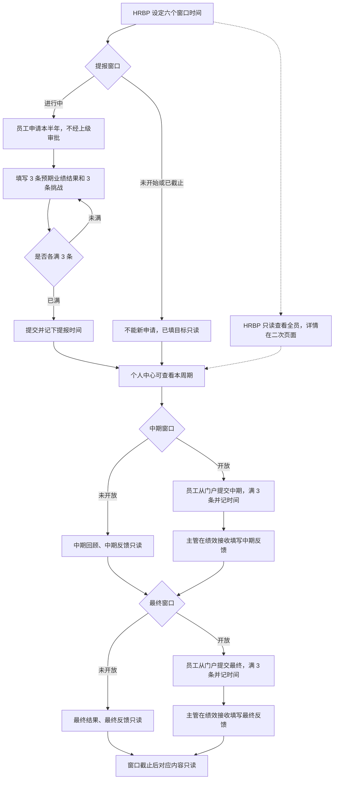

# 提报绩效 S · 功能流程

> 一个半年一条记录。HRBP 定窗口，员工提报并回写中期与最终，主管在接收页写反馈。HRBP 只读查看。

时间顺序：开始提报早于截止提报，截止提报不晚于开放中期，开放中期早于截止中期，截止中期不晚于开放最终，开放最终早于截止最终。

## 流程图

## 谁写哪一栏

| 内容 | 员工 | 主管 | HRBP |
|------|------|------|------|
| 预期业绩结果、挑战 | 提报窗口内填写 | 只读 | 只读 |
| 中期回顾 | 门户入口。只显示已有目标；没有的由用户加一条并自填原文。写满 3 条后提交，窗口内可再交，时间以最后一次为准 | 只读 | 只读，看提交时间 |
| 中期反馈 | 只读 | 中期窗口内，在绩效接收填写 | 只读 |
| 最终结果 | 门户入口。只显示已有目标；没有的由用户加一条并自填原文。写满 3 条后提交，窗口内可再交，时间以最后一次为准 | 只读 | 只读，看提交时间 |
| 最终反馈 | 只读 | 最终窗口内，在绩效接收填写 | 只读 |

主管接收页只含本组员工。HRBP 管理页看全员，详情不在列表内展开。

## 页面

| 角色 | 页面 |
|------|------|
| 员工 | 门户「提报绩效 S」「中期回顾」「最终结果」、个人中心绩效 S |
| 主管 | 门户「绩效 S 接收」 |
| HRBP | 后台「绩效 S 管理」、绩效 S 详情 |

---

作者：@beynawoo-code
